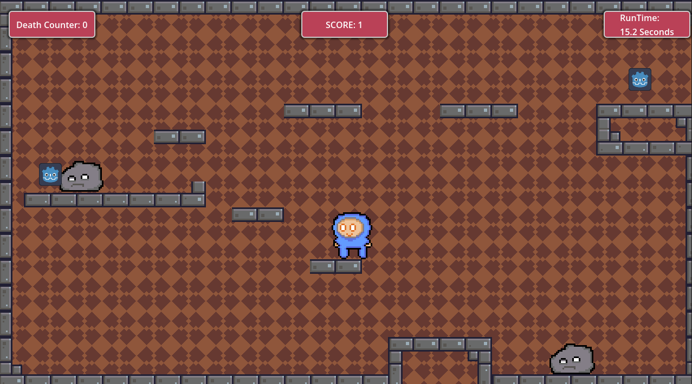

 

# DugDownDeep V0.1

A 2D platformer that was made on Godot where you the player is stuck deep underground and trying to get up to the surface by beating the challenge of each platformer level and collecting gold while evading enemies.

## How to Play
* You can control the player by using AWD or arrows and space to move left and right and jump.
* Jump on platforms and evade rock enemies and collect gold as you travel from level to level
* More moving mechanisms are planned for future updates in the upcoming weeks
---

## Where to play
You can access the game by running it on browser on itch.io on this demo link: [Demo Link](https://mono-nezar.itch.io/dugdowndeep)

Screenshot of the game: 

---

This Game is still in version Beta 0.1v 

so it might have bugs and incomplete levels and also placeholders for now

---
## Upcoming Updates:
* More art so no placeholders
* Mobile Optimization.
* A better level design 
* More levels
* A story 
* Attacking mechanism like a pickaxe to attack the stone enemies
* Shop to spend your gold

---
The Game Design and Code and Pixel art were all made by Mono Nezar 